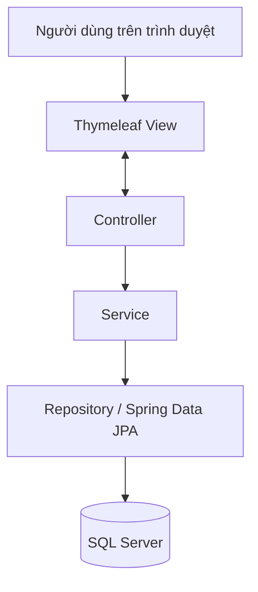

<div align="center">

# 📚 Book Management System

### Ứng dụng web quản lý sách được xây dựng với Spring Boot

Quản lý thông tin sách, danh mục và quyền truy cập trong một giao diện web đơn giản, dễ sử dụng.

<p>
  
  
  
  
  
</p>

</div>

---

## ✨ Giới thiệu

**Book Management System** là ứng dụng web quản lý sách được phát triển bằng Java và Spring Boot. Dự án tập trung vào các chức năng quản lý dữ liệu cơ bản, kết nối cơ sở dữ liệu quan hệ và tổ chức mã nguồn theo các lớp Controller, Service và Repository.

Ứng dụng cho phép người dùng xem và tìm kiếm sách; tài khoản có quyền quản trị có thể thêm, cập nhật và xóa sách. Mỗi cuốn sách được liên kết với một danh mục để việc phân loại và hiển thị dữ liệu rõ ràng hơn.

## 🚀 Chức năng chính

| Chức năng | Mô tả |
|---|---|
| 📖 Quản lý sách | Xem danh sách, thêm mới, chỉnh sửa và xóa sách |
| 🔎 Tìm kiếm | Tìm sách theo tên sách hoặc tên tác giả |
| 🗂️ Quản lý danh mục | Gắn sách với danh mục tương ứng và chọn danh mục khi tạo/sửa sách |
| 🔐 Đăng nhập | Lưu thông tin đăng nhập bằng session để kiểm tra quyền truy cập |
| 👥 Phân quyền | Phân biệt quyền quản trị và người dùng; giới hạn thao tác quản lý sách theo vai trò |
| ✅ Kiểm tra dữ liệu | Sử dụng Jakarta Bean Validation để kiểm tra dữ liệu khi gửi biểu mẫu |
| 🧩 Kiểm tra mã sách | Phát hiện ID sách trùng khi tạo mới và hiển thị thông báo cho người dùng |
| 🖥️ Giao diện web | Hiển thị dữ liệu bằng Thymeleaf, HTML và CSS |

## 🛠️ Công nghệ sử dụng

- **Java 21** — ngôn ngữ lập trình chính.
- **Spring Boot** — xây dựng và cấu hình ứng dụng web.
- **Spring Web MVC** — tiếp nhận request và điều hướng giữa các trang.
- **Spring Data JPA / Hibernate** — ánh xạ đối tượng Java với dữ liệu quan hệ và thực hiện thao tác dữ liệu.
- **Thymeleaf** — kết xuất giao diện HTML động.
- **Microsoft SQL Server** — lưu trữ dữ liệu sách, danh mục và tài khoản.
- **Jakarta Bean Validation** — kiểm tra dữ liệu đầu vào.
- **Maven** — quản lý dependency và build dự án.

## 🧱 Cách tổ chức ứng dụng

Dự án áp dụng cách tổ chức nhiều lớp để tách phần nhận yêu cầu, xử lý nghiệp vụ và truy cập dữ liệu.



- **Controller:** tiếp nhận request, kiểm tra trạng thái đăng nhập/quyền truy cập và chuẩn bị dữ liệu cho trang.
- **Service:** tập trung các thao tác nghiệp vụ liên quan đến sách và danh mục.
- **Repository:** làm việc với cơ sở dữ liệu thông qua Spring Data JPA.
- **Entity:** biểu diễn các thực thể như sách, danh mục và tài khoản.
- **Thymeleaf templates:** hiển thị danh sách sách, biểu mẫu tạo/chỉnh sửa và các thông báo cho người dùng.

## 💻 Yêu cầu môi trường

Trước khi chạy dự án, cần chuẩn bị:

- JDK 21.
- Microsoft SQL Server đang hoạt động.
- IntelliJ IDEA hoặc IDE hỗ trợ Maven.
- Git (nếu muốn clone source code từ GitHub).

## ⚙️ Cài đặt và chạy ứng dụng

### 1. Clone dự án

```bash
git clone https://github.com/tuilahau/spring-boot-book-manager.git
cd spring-boot-book-manager
```

### 2. Tạo cơ sở dữ liệu

Tạo database `Bookstore` trên SQL Server, hoặc sửa cấu hình để dùng tên database khác. Đảm bảo SQL Server cho phép kết nối bằng thông tin tài khoản của môi trường phát triển.

### 3. Cấu hình kết nối database

Mở `src/main/resources/application.properties` và cấu hình URL, username, password theo máy của bạn. Không đưa mật khẩu thật hoặc thông tin kết nối cá nhân lên GitHub. Với môi trường làm việc thực tế, nên chuyển thông tin nhạy cảm sang biến môi trường và tham chiếu chúng từ file cấu hình.

**Lưu ý:** cấu hình hiện tại dùng `spring.jpa.hibernate.ddl-auto=create`. Hibernate có thể tạo lại cấu trúc bảng khi ứng dụng khởi động, vì vậy chỉ dùng với dữ liệu thử nghiệm có thể tạo lại. Trước khi lưu dữ liệu quan trọng, hãy cân nhắc chuyển sang `update` hoặc một chiến lược quản lý schema phù hợp.

### 4. Khởi chạy

Có thể mở dự án trong IntelliJ IDEA và chạy lớp khởi động Spring Boot. Hoặc dùng Maven Wrapper ở thư mục gốc:

**Windows**

```powershell
.\mvnw.cmd spring-boot:run
```

**macOS / Linux**

```bash
chmod +x mvnw
./mvnw spring-boot:run
```

Theo cấu hình hiện tại, ứng dụng chạy tại:

```text
http://localhost:6969
```

Mở trang đăng nhập của ứng dụng trong trình duyệt và sử dụng tài khoản đã được thiết lập trong database/môi trường của bạn.

## 🔐 Lưu ý bảo mật

- Không sử dụng tài khoản/mật khẩu mẫu trong môi trường thật.
- Không commit thông tin đăng nhập SQL Server, token hoặc dữ liệu cá nhân.
- Nếu thông tin đăng nhập từng được đẩy lên repository công khai, hãy thay đổi mật khẩu đó và chuyển cấu hình sang biến môi trường. Xóa khỏi commit mới không tự loại bỏ thông tin khỏi lịch sử Git.
- Với ứng dụng triển khai thực tế, nên bổ sung Spring Security và kiểm tra quyền truy cập tập trung thay vì chỉ dựa vào các điều kiện kiểm tra trong controller.

## 🗺️ Hướng phát triển

- Chuyển cấu hình nhạy cảm sang biến môi trường/profile riêng.
- Bổ sung phân trang và sắp xếp danh sách sách.
- Hoàn thiện quản lý danh mục và tài khoản trên giao diện quản trị.
- Bổ sung kiểm thử cho service, controller và validation.
- Cải thiện giao diện responsive và bổ sung ảnh chụp màn hình ứng dụng.
- Tăng cường xác thực và phân quyền bằng Spring Security.

## 👨‍💻 Mục tiêu học tập

Dự án được xây dựng nhằm thực hành phát triển ứng dụng web Java với Spring Boot, mô hình MVC, Dependency Injection, Spring Data JPA, quan hệ giữa các entity, xử lý biểu mẫu Thymeleaf, validation và kết nối SQL Server.

---

<div align="center">

**Book Management System** · Java & Spring Boot

</div>
